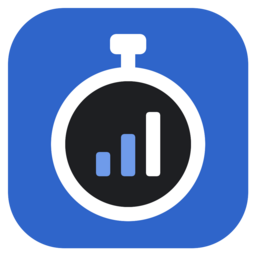

<p align="center">
  
</p>

<h1 align="center">StudyTracker</h1>

<p align="center">
  A lightweight study-time tracker for Linux and Android, with charts, a task list
  and encrypted phone ↔ computer sync over your local Wi-Fi.
</p>

<p align="center">
  
  
  
</p>

---

## Features

**⏱ Stopwatch per subject**
- A small always-handy window with Start / Pause / Resume / Stop.
- Expand it into a full dashboard to switch subjects, add new ones and pick their colors.
- Progress is checkpointed continuously, so a crash or power loss never loses a session.

**📊 Charts**
- **Today** and **This week** views — click a view again to cycle through chart types:
  - *Totals* — one bar per subject,
  - *Cumulative* — lines showing how study time built up over the day/week,
  - *Daily* — stacked bars for each day of the week (week view only).
- Browse any **previous week** and compare against weekly averages.
- Filter charts to a single subject; hover (or tap on the phone) for details.
- Tasks you complete while studying appear on the charts as badges.

**✅ Tasks**
- To-do list with optional subject and deadline, sorted by the nearest due date.
- Tick tasks off with a small animation; a task finished during a study session
  (or up to 30 minutes after it) is credited to that session.
- Right-click (or long-press on Android) to change the deadline or delete a task.

**📱 Android app**
- Same app, phone-friendly layout with tabs.
- Ongoing notification with the running timer and Pause / Stop buttons, so it keeps
  counting while the app is in the background.

**🔄 Phone ↔ computer sync**
- No cloud, no account — devices talk directly over the same Wi-Fi network.
- The phone finds the computer automatically (UDP broadcast) and syncs in the background
  every ~15 minutes and whenever the network changes.
- Pair once with a 20-character code shown on the computer; the code itself is never
  sent over the network. All traffic is encrypted with **AES-256-GCM**.
- Merging is additive — nothing is lost. If the same field was edited on both devices,
  the computer wins.

**🖥 Desktop integration (Linux)**
- `cmake --install` adds a launcher entry and icon to your application menu.
- The installed app enables autostart (minimized) so your phone always has something to
  sync with — toggle it in *Sync with phone…*.
- Dark theme out of the box.

## Building

### Requirements

| | Desktop (Linux) | Android |
|---|---|---|
| CMake | ≥ 4.1 | ≥ 4.1 |
| Qt 6 | Core, Gui, Widgets, Sql, Network | Qt for Android (arm64-v8a) + host Qt |
| Other | OpenSSL (libcrypto) | Android SDK, NDK r27, JDK 17 |

### Desktop

```bash
cmake -S . -B build -DCMAKE_BUILD_TYPE=Release
cmake --build build
cmake --install build      # installs to ~/.local by default
```

Then launch **StudyTracker** from your application menu, or run `~/.local/bin/LearningTimeAnalizer`.

Command-line options:

| Option | Effect |
|---|---|
| `--minimized` | Start minimized (used by autostart) |
| `--mobile` | Show the phone layout in a desktop window (handy for testing) |

### Android

```bash
export JAVA_HOME=/path/to/jdk-17

/path/to/Qt/6.x/android_arm64_v8a/bin/qt-cmake -S . -B build-android -G Ninja \
    -DCMAKE_BUILD_TYPE=Debug \
    -DQT_HOST_PATH=/path/to/Qt/6.x/gcc_64 \
    -DANDROID_SDK_ROOT=$HOME/Android/Sdk \
    -DANDROID_NDK_ROOT=$HOME/Android/Sdk/ndk/<version>

cmake --build build-android --target apk
adb install build-android/android-build/build/outputs/apk/debug/*.apk
```

A `Debug` build produces a debug-signed APK that installs right away; `Release` produces an
unsigned one you need to sign yourself.

## Syncing your phone

1. On the computer, open the dashboard and click **Sync with phone…** — note the pairing code.
2. On the phone, tap **Sync with computer** and enter the code.
3. That's it — from now on the phone syncs automatically whenever both devices are on the
   same network.

> The computer listens on TCP/UDP port **47815**. If you use a firewall, allow it on your
> local network.

## Where data lives

- **Linux:** `~/.local/share/StudyTracker/` (SQLite database)
- **Android:** the app's private storage

## Project layout

| File | Purpose |
|---|---|
| `main.cpp` | App startup, dark theme, window placement |
| `TrackerWindow.*` | Main window: stopwatch, dashboard, tasks, phone layout |
| `ChartWidget.*` | Custom-painted charts |
| `Counter.*` | Stopwatch logic and crash-safe session recording |
| `Database.*` | SQLite storage, export and merge for sync |
| `Sync.*` | Pairing, discovery, encryption and the desktop sync server |
| `Autostart.*` | Linux autostart entry |
| `AndroidBridge.*` | Notification and other Android-only hooks |
| `android/` | Manifest, launcher icons and Java services (timer notification, background sync) |
| `icons/` | App icon (SVG + PNG) |
